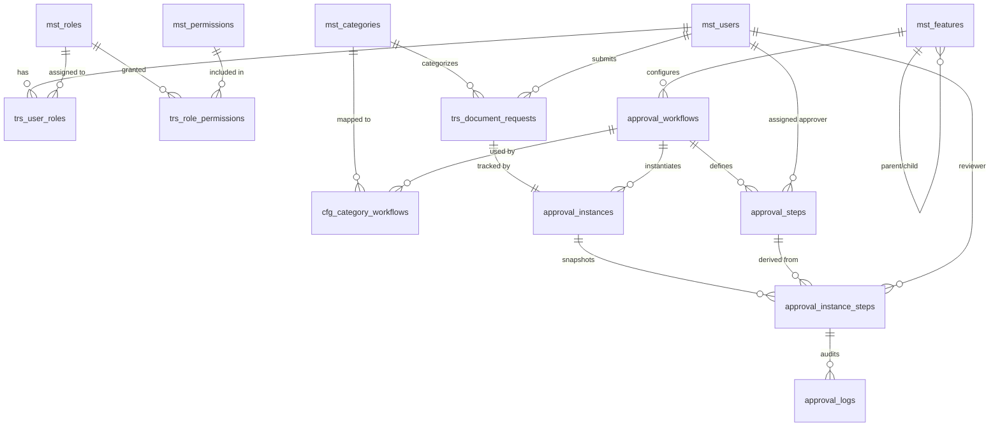
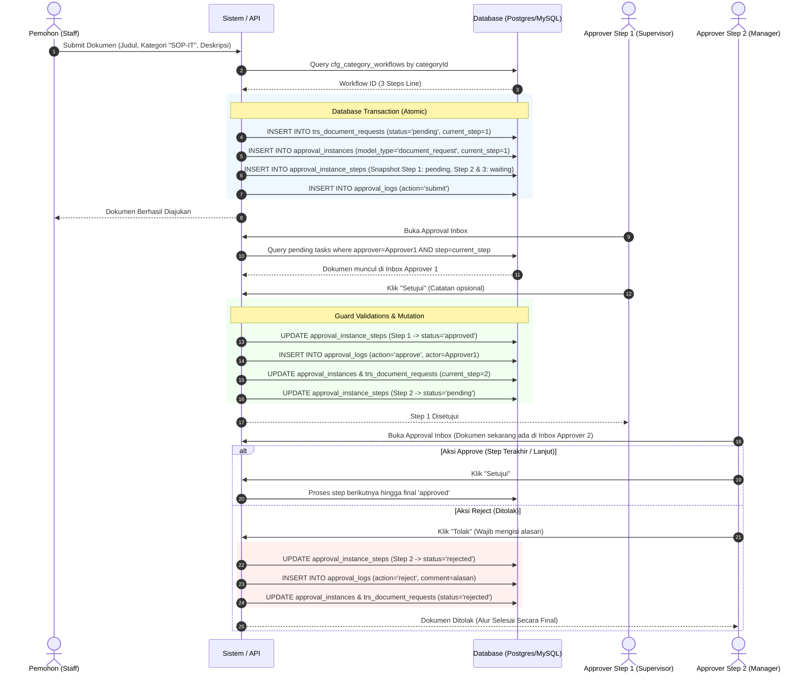

# Dokumentasi Database: Document Request & Approval Engine

Dokumentasi ini menjelaskan arsitektur, skema tabel, relasi antar entitas, serta alur data pada sistem **Document Request & Approval Line** berbasis **Drizzle ORM** dengan dukungan dual-database engine (**PostgreSQL** dan **MySQL**).

---

## 1. Konsep Arsitektur Database

Database dirancang dengan memisahkan 4 domain utama:

1. **User Management & RBAC (Role-Based Access Control)**:
   Mengatur identitas pengguna, hak akses (*permissions*), dan pengelompokan peran (*roles*).
2. **Master Data & System Features**:
   Menyimpan data referensi umum seperti kategori dokumen (`mst_categories`) dan registrasi fitur sistem (`mst_features`).
3. **Approval Engine (Template vs Runtime Snapshot)**:
   - **Template Workflow** (`approval_workflows`, `approval_steps`): Definisi alur persetujuan umum (siapa saja approver dan urutannya).
   - **Runtime Instance Snapshot** (`approval_instances`, `approval_instance_steps`, `approval_logs`): Saat dokumen diajukan, alur approval di-*snapshot* (disalin) menjadi instans transaksi independen. Jika di masa depan konfigurasi template berubah, pengajuan lama tidak akan terpengaruh (*audit trail integrity*).
4. **Document Request Domain**:
   Menyimpan transaksi pengajuan dokumen (`trs_document_requests`) dan relasi pemetaan alur approval per kategori (`cfg_category_workflows`).

---

## 2. Entity-Relationship Diagram (ERD)

---

## 3. Rincian Kamus Data (Data Dictionary)

### 3.1 Domain User & RBAC

#### `mst_users`
Menyimpan data kredensial dan identitas pengguna sistem.
| Kolom | Tipe Data (PG / MySQL) | Constraint | Deskripsi |
|---|---|---|---|
| `id` | `serial` / `bigint` | PK, Auto Increment | ID unik user |
| `username` | `varchar(50)` | NOT NULL, UNIQUE (soft-delete aware) | Username untuk login |
| `email` | `varchar(255)` | NOT NULL, UNIQUE (soft-delete aware) | Email user |
| `name` | `varchar(255)` | NOT NULL | Nama lengkap user |
| `password_hash` | `varchar(255)` | NULLABLE | Hash kata sandi (bcrypt) |
| `is_active` | `boolean` | DEFAULT `true` | Status keaktifan akun |
| `created_at` | `timestamp` | DEFAULT `NOW()` | Waktu pembuatan |
| `updated_at` | `timestamp` | DEFAULT `NOW()` | Waktu pembaruan terakhir |
| `deleted_at` | `timestamp` | NULLABLE | Penanda soft-delete |

#### `mst_roles`
Menyimpan daftar peran (*role*) dalam sistem (contoh: `super-admin`, `admin`, `staff`, `approver`, `viewer`).
| Kolom | Tipe Data | Constraint | Deskripsi |
|---|---|---|---|
| `id` | `serial` / `bigint` | PK, Auto Increment | ID unik role |
| `name` | `varchar(100)` | NOT NULL, UNIQUE | Nama unik role |
| `guard_name` | `varchar(100)` | DEFAULT `'web'` | Scope guard otentikasi |
| `is_system` | `boolean` | DEFAULT `false` | Penanda role bawaan sistem |
| `is_active` | `boolean` | DEFAULT `true` | Status keaktifan |
| `created_at` / `updated_at` / `deleted_at` | `timestamp` | - | Audit waktu & soft-delete |

#### `mst_permissions`
Menyimpan hak akses granular sistem (contoh: `document-request.view`, `document-request.manage`, `approval.review`).
| Kolom | Tipe Data | Constraint | Deskripsi |
|---|---|---|---|
| `id` | `serial` / `bigint` | PK, Auto Increment | ID unik permission |
| `name` | `varchar(100)` | NOT NULL, UNIQUE | Kode permission |
| `description` | `text` | NULLABLE | Deskripsi fungsionalitas |
| `guard_name` | `varchar(100)` | DEFAULT `'web'` | Scope guard otentikasi |
| `created_at` / `updated_at` / `deleted_at` | `timestamp` | - | Audit waktu & soft-delete |

#### `trs_user_roles`
Tabel *junction* yang menghubungkan user dengan peran (*many-to-many*).
| Kolom | Tipe Data | Constraint | Deskripsi |
|---|---|---|---|
| `id` | `serial` / `bigint` | PK, Auto Increment | ID unik mapping |
| `user_id` | `bigint` | FK &rarr; `mst_users(id)`, NOT NULL | Referensi user |
| `role_id` | `bigint` | FK &rarr; `mst_roles(id)`, NOT NULL | Referensi role |
| `created_at` | `timestamp` | DEFAULT `NOW()` | Waktu assignment |

#### `trs_role_permissions`
Tabel *junction* yang menghubungkan peran dengan izin akses (*many-to-many*).
| Kolom | Tipe Data | Constraint | Deskripsi |
|---|---|---|---|
| `id` | `serial` / `bigint` | PK, Auto Increment | ID unik mapping |
| `role_id` | `bigint` | FK &rarr; `mst_roles(id)`, NOT NULL | Referensi role |
| `permission_id` | `bigint` | FK &rarr; `mst_permissions(id)`, NOT NULL | Referensi permission |
| `created_at` | `timestamp` | DEFAULT `NOW()` | Waktu assignment |

---

### 3.2 Domain Master Data & Modul Sistem

#### `mst_categories`
Kategori dokumen SOP (contoh: SOP Teknologi Informasi, SOP Keuangan, SOP HR).
| Kolom | Tipe Data | Constraint | Deskripsi |
|---|---|---|---|
| `id` | `serial` / `bigint` | PK, Auto Increment | ID unik kategori |
| `code` | `varchar(20)` | NULLABLE | Kode singkatan (e.g. `SOP-IT`) |
| `name` | `varchar(100)` | NOT NULL | Nama kategori dokumen |
| `description` | `text` | NULLABLE | Penjelasan kategori & aturan approval |
| `is_active` | `boolean` | DEFAULT `true` | Status keaktifan |
| `created_at` / `updated_at` / `deleted_at` | `timestamp` | - | Audit waktu & soft-delete |

#### `mst_features`
Daftar modul aplikasi untuk kontrol navigasi menu dan relasi fitur approval.
| Kolom | Tipe Data | Constraint | Deskripsi |
|---|---|---|---|
| `id` | `serial` / `bigint` | PK, Auto Increment | ID unik fitur |
| `parent_id` | `bigint` | FK &rarr; `mst_features(id)`, NULLABLE | Relasi sub-menu/parent |
| `code` | `varchar(50)` | NOT NULL | Kode modul (e.g. `DOCUMENT_REQUEST`) |
| `name` | `varchar(100)` | NOT NULL | Label tampilan menu |
| `route_path` | `varchar(255)` | NOT NULL | URL path dashboard |
| `icon` | `varchar(50)` | DEFAULT `'LayoutDashboard'` | Ikon lucide-react |
| `sort_order` | `integer` | DEFAULT `0` | Urutan tampilan |
| `is_active` | `boolean` | DEFAULT `true` | Status keaktifan |
| `created_at` / `updated_at` / `deleted_at` | `timestamp` | - | Audit waktu & soft-delete |

---

### 3.3 Domain Approval Engine (Template)

#### `approval_workflows`
Template alur persetujuan untuk modul/fitur tertentu.
| Kolom | Tipe Data | Constraint | Deskripsi |
|---|---|---|---|
| `id` | `serial` / `bigint` | PK, Auto Increment | ID unik workflow |
| `feature_id` | `bigint` | FK &rarr; `mst_features(id)`, NOT NULL | Fitur yang dinaungi |
| `name` | `varchar(100)` | NOT NULL | Nama workflow (e.g. *SOP IT Approval Line*) |
| `division_id` | `bigint` | NULLABLE | Opsional divisi |
| `department_id` | `bigint` | NULLABLE | Opsional departemen |
| `is_active` | `boolean` | DEFAULT `true` | Status keaktifan |
| `created_at` / `updated_at` | `timestamp` | DEFAULT `NOW()` | Audit waktu |

#### `approval_steps`
Langkah-langkah berurutan (*sequential steps*) pada sebuah template workflow.
| Kolom | Tipe Data | Constraint | Deskripsi |
|---|---|---|---|
| `id` | `serial` / `bigint` | PK, Auto Increment | ID unik step template |
| `workflow_id` | `bigint` | FK &rarr; `approval_workflows(id)`, NOT NULL | Relasi ke workflow |
| `step` | `integer` | NOT NULL | Urutan step (1, 2, 3, ...) |
| `group_no` | `integer` | DEFAULT `1` | Nomor grup approval |
| `code` | `varchar(50)` | NULLABLE | Kode langkah (e.g. `STEP-1-SPV`) |
| `approver_type` | `varchar(20)` | NOT NULL | Tipe penugasan (`user`, `job_level`, dll) |
| `user_id` | `bigint` | FK &rarr; `mst_users(id)`, NULLABLE | User spesifik yang ditugaskan |
| `group_type` | `varchar(20)` | DEFAULT `'SEQUENTIAL'` | Jenis alur (`SEQUENTIAL` / `PARALLEL`) |
| `min_approval` | `integer` | DEFAULT `1` | Minimal kuorum persetujuan |
| `is_required` | `boolean` | DEFAULT `true` | Wajib approve |
| `allowed_actions` | `varchar(255)` | DEFAULT `'approve,reject'` | Aksi yang diizinkan |
| `created_at` | `timestamp` | DEFAULT `NOW()` | Waktu pembuatan |

---

### 3.4 Domain Document Request & Category Mapping (Tabel Baru)

#### `cfg_category_workflows`
Tabel pemetaan antara Kategori Dokumen dengan Template Workflow Approval. Menghubungkan kategori ke approval line tanpa mengubah skema tabel bawaan.
| Kolom | Tipe Data | Constraint | Deskripsi |
|---|---|---|---|
| `id` | `serial` / `bigint` | PK, Auto Increment | ID unik konfigurasi |
| `category_id` | `bigint` | FK &rarr; `mst_categories(id)`, UNIQUE, NOT NULL | Kategori dokumen |
| `workflow_id` | `bigint` | FK &rarr; `approval_workflows(id)`, NOT NULL | Workflow approval yang digunakan |
| `created_at` | `timestamp` | DEFAULT `NOW()` | Waktu konfigurasi |

#### `trs_document_requests`
Menyimpan transaksi data pengajuan dokumen SOP oleh pengguna.
| Kolom | Tipe Data | Constraint | Deskripsi |
|---|---|---|---|
| `id` | `serial` / `bigint` | PK, Auto Increment | ID transaksi dokumen |
| `document_number` | `varchar(50)` | NOT NULL, UNIQUE | Nomor pengajuan (e.g. `DOC-202611-1089`) |
| `title` | `varchar(255)` | NOT NULL | Judul dokumen SOP |
| `description` | `text` | NULLABLE | Deskripsi / ringkasan dokumen |
| `category_id` | `bigint` | FK &rarr; `mst_categories(id)`, NOT NULL | Kategori dokumen terpilih |
| `user_id` | `bigint` | FK &rarr; `mst_users(id)`, NOT NULL | User pemohon (*requester*) |
| `status` | `varchar(20)` | DEFAULT `'pending'`, NOT NULL | Status dokumen: `pending`, `approved`, `rejected` |
| `current_step` | `integer` | DEFAULT `1`, NOT NULL | Posisi nomor step approval yang aktif |
| `total_steps` | `integer` | DEFAULT `1`, NOT NULL | Total langkah yang harus dilalui |
| `created_at` | `timestamp` | DEFAULT `NOW()` | Waktu submit pengajuan |
| `updated_at` | `timestamp` | DEFAULT `NOW()` | Waktu update terakhir |
| `deleted_at` | `timestamp` | NULLABLE | Penanda soft-delete |

---

### 3.5 Domain Approval Runtime & Audit Trail

#### `approval_instances`
Instans persetujuan hidup untuk setiap dokumen transaksi.
| Kolom | Tipe Data | Constraint | Deskripsi |
|---|---|---|---|
| `id` | `serial` / `bigint` | PK, Auto Increment | ID unik instance |
| `workflow_id` | `bigint` | FK &rarr; `approval_workflows(id)`, NOT NULL | Template workflow yang dipakai |
| `model_type` | `varchar(100)` | NOT NULL | Entitas target (`'document_request'`) |
| `model_id` | `varchar(36)` | NOT NULL | ID transaksi target (ID dokumen) |
| `current_step` | `integer` | DEFAULT `1` | Indeks step yang sedang menunggu review |
| `status` | `varchar(20)` | DEFAULT `'pending'` | Status instance: `pending`, `approved`, `rejected` |
| `created_at` / `updated_at` | `timestamp` | DEFAULT `NOW()` | Audit waktu |

#### `approval_instance_steps`
Snapshot daftar approver nyata per transaksi dokumen.
| Kolom | Tipe Data | Constraint | Deskripsi |
|---|---|---|---|
| `id` | `serial` / `bigint` | PK, Auto Increment | ID unik step snapshot |
| `instance_id` | `bigint` | FK &rarr; `approval_instances(id)`, NOT NULL | Relasi ke instance transaksi |
| `step_id` | `bigint` | FK &rarr; `approval_steps(id)`, NOT NULL | Referensi ke step template asal |
| `approver_user_id` | `bigint` | FK &rarr; `mst_users(id)`, NOT NULL | User approver yang ditugaskan |
| `status` | `varchar(20)` | DEFAULT `'pending'` | Status step: `waiting`, `pending`, `approved`, `rejected` |
| `approved_at` | `timestamp` | NULLABLE | Waktu persetujuan dieksekusi |
| `employee_name` | `varchar(100)` | NULLABLE | Snapshot nama approver |
| `notes` | `text` | NULLABLE | Catatan / alasan dari approver |
| `created_at` | `timestamp` | DEFAULT `NOW()` | Waktu instansiasi |

#### `approval_logs`
Catatan riwayat audit lengkap (*immutable audit trail*) setiap aksi yang terjadi pada proses approval.
| Kolom | Tipe Data | Constraint | Deskripsi |
|---|---|---|---|
| `id` | `serial` / `bigint` | PK, Auto Increment | ID log |
| `instance_step_id` | `bigint` | FK &rarr; `approval_instance_steps(id)`, NOT NULL | Step yang diaudit |
| `action` | `varchar(20)` | NOT NULL | Jenis aksi: `'submit'`, `'approve'`, `'reject'` |
| `comment` | `text` | NULLABLE | Komentar / catatan penolakan/persetujuan |
| `created_at` | `timestamp` | DEFAULT `NOW()` | Waktu aksi dicatat |

---

## 4. Siklus Hidup Transaksi (Transaction Lifecycle)

---

## 5. Keputusan Desain & Penjaminan Integritas Data

1. **Dual-Dialect Type Safety**:
   Skema PostgreSQL menggunakan tipe `pgTable`, `serial`, `timestamp`, dan `bigint({ mode: 'number' })`. Sedangkan skema MySQL menggunakan `mysqlTable`, `int`, dan `bigint({ mode: 'number', unsigned: true })`. Keduanya diekspor di bawah interface TypeScript yang identik sehingga kode repository dan usecase tidak perlu diubah saat mengganti database.
2. **Snapshotting Approver (Audit Trail Integrity)**:
   Data approver disalin ke tabel `approval_instance_steps` pada saat dokumen dibuat. Hal ini menjamin bahwa jika di kemudian hari konfigurasi `approval_steps` pada master diubah, riwayat siapa yang menyetujui dokumen lama tetap akurat dan tidak berubah.
3. **Pencegahan Self-Approval**:
   Pada layer database query dan usecase, sistem memastikan integritas pemisahan tugas (*Segregation of Duties*):
   $$\text{doc.userId} \neq \text{session.userId}$$
   Pemohon tidak dapat menjadi approver dokumennya sendiri pada step manapun.
4. **Pencegahan Race Condition**:
   Setiap mutasi approve/reject dieksekusi di dalam transaksi database atomik dengan validasi status baris (`WHERE id = :stepId AND status = 'pending'`). Jika terdapat klik ganda atau akses paralel, hanya 1 aksi yang berhasil dan aksi berikutnya akan dibatalkan secara bersih.

